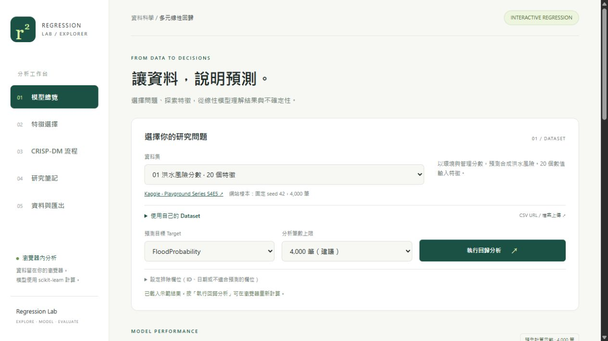
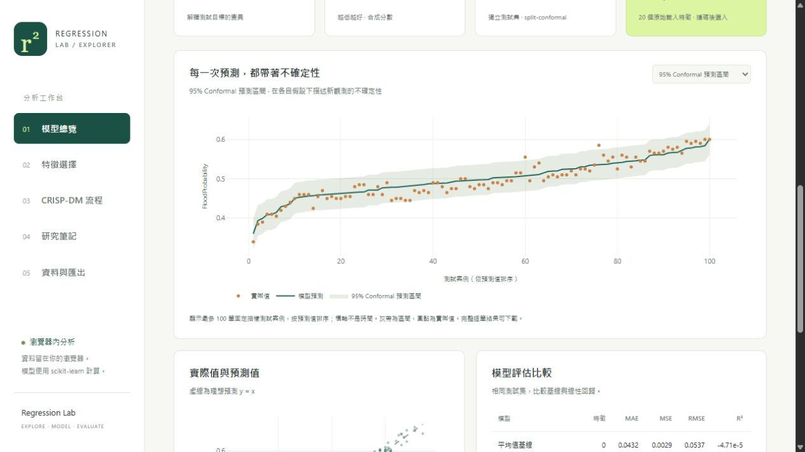

# AIoT-DA 課程作業｜AI Vibe Coding 多元線性回歸 HW2

## 我的專案連結

- **網站網址**：[https://hitomihuang.github.io/HW2_MULTIPLE_LINEAR_REGRESSION/](https://hitomihuang.github.io/HW2_MULTIPLE_LINEAR_REGRESSION/)
- **GitHub 儲存庫網址**：[https://github.com/HitomiHuang/HW2_MULTIPLE_LINEAR_REGRESSION](https://github.com/HitomiHuang/HW2_MULTIPLE_LINEAR_REGRESSION)

> **作業主題**：運用 AI 輔助開發多元線性回歸資料分析與預測網站\
> **專案名稱**：Regression Lab｜多元線性回歸\
> **資料來源**：Kaggle 洪水合成資料（Playground Series S4E5）與 King County 房價資料

## 專案文件

[下載整合分析報告（PDF）](output/pdf/regression_lab_complete_report.pdf)

文件包含資訊圖表、CRISP-DM 分析、模型評估、GPT 輔助內容、NotebookLM 摘要，以及 ChatGPT 技術問答截圖。

## 網站畫面

資料集切換與分析設定：



95% 預測區間與預測結果：



## 可以做什麼

- 切換洪水風險分數、King County 房價，或透過 CSV 網址與檔案上傳匯入資料。
- 選擇預測目標、排除欄位與分析筆數，執行特徵選擇及線性回歸。
- 比較 MAE、MSE、RMSE、R² 與調整 R²，查看殘差、Q-Q 圖及回歸係數。
- 切換 95% conformal 預測區間、OLS 平均反應信賴區間與 OLS 單筆預測區間。
- 下載分析結果 JSON、逐筆預測 CSV 與目前資料集，或將結果列印為 PDF。

## 資料集與示範結果

| 資料集 | 原始輸入特徵 | 預測目標 | 測試 RMSE | 測試 R² | 95% 區間實測覆蓋率 |
|---|---:|---|---:|---:|---:|
| [洪水分數](https://www.kaggle.com/competitions/playground-series-s4e5/data) | 20 | FloodProbability | 0.020139 | 0.859509 | 94.625% |
| [King County 房價](https://www.kaggle.com/datasets/harlfoxem/housesalesprediction) | 18 | price（USD） | 214,640.38 | 0.678480 | 96.375% |

兩個內建資料集各使用固定抽取的 4,000 筆樣本，分為 2,400 筆訓練、800 筆校準與 800 筆測試資料。原始特徵數不包含目標、索引、ID 與日期；類別編碼後欄數另行顯示。

自訂資料可使用 [50 Startups CSV](https://raw.githubusercontent.com/Avik-Jain/100-Days-Of-ML-Code/master/datasets/50_Startups.csv)，以 `Profit` 為預測目標。這份資料有 50 筆觀測、4 個原始輸入特徵，包含可編碼的 `State` 類別欄位。

## 使用方式

1. 選擇內建資料集，或展開「使用自己的 Dataset」載入 CSV。
2. 確認 Target、排除欄位與分析筆數。
3. 按「執行回歸分析」，再從導覽列查看模型總覽、特徵選擇與分析流程。
4. 在「資料與匯出」下載結果。

首次執行需下載 Python 與分析套件，約需 30–90 秒，視網路而定。內建示範可立即查看；自訂資料在瀏覽器內運算，不送至網站伺服器。CSV 網址需允許 CORS，受限時可下載後上傳。支援 UTF-8 CSV/TSV，檔案最多 10 MB、至少 30 筆有效目標，分析筆數可選 1,000、4,000 或 10,000 筆上限。

## 分析方法

依 CRISP-DM 串連問題定義、資料理解、前處理、建模、評估與部署。使用 scikit-learn 的 `Pipeline`、`SelectKBest` 與 `LinearRegression`；中位數補值、標準化及類別編碼都只在訓練折內估計。五折交叉驗證比較保留 1 欄、50%、75% 與全部編碼特徵，依平均 RMSE 選擇設定，測試集不參與選模。

95% split-conformal 區間使用獨立校準集的絕對殘差排序建立，需要校準與新資料可交換的前提；實測覆蓋率不代表每個子群的保證。小樣本至少保留 19 筆校準，因此 50 Startups 切為 21 筆訓練、19 筆校準、10 筆測試。OLS 區間另有模型假設，且未校正特徵選擇帶來的不確定性。

洪水資料是合成分數，房價資料是 2014–2015 年歷史交易。房價欄位有精確共線性，程式會提示矩陣秩不足並採 SVD 解；zipcode 的數值表示也是此基線的限制。隨機切分結果不代表跨時期或跨地區的泛化表現。

## 本機執行

建議使用 Python 3.12，在專案根目錄執行：

```bash
python -m pip install -r requirements.txt
python -m http.server 8765 --directory web/dist
```

瀏覽器開啟 `http://localhost:8765`。也可使用與網站共用分析引擎的 CLI：

```bash
python analyze_dataset.py --problem flood
python analyze_dataset.py --problem housing
python analyze_dataset.py --input data/50_Startups.csv --target Profit
```

## 研究與來源

GPT 協助程式、圖表與文字整理，模型指標由實際程式計算。[NotebookLM 研究筆記](notebooklm_research.md)整理洪水資料的特徵工程、資料洩漏與區間估計；完整摘要與來源可在網站「研究筆記」閱讀。

- [scikit-learn：避免資料洩漏](https://scikit-learn.org/stable/common_pitfalls.html)
- [Conformal prediction 教學](https://arxiv.org/abs/2107.07511)
- [King County CSV 取得來源](https://github.com/rheera/data-analysis-with-python/blob/main/kc_house_data.csv)

更多來源與授權記錄見 [sources.md](sources.md) 與 [DATA_LICENSE.md](DATA_LICENSE.md)。

## GitHub Pages 部署

網站由 GitHub Actions 將 `web/dist/` 發布至 GitHub Pages。推送網站檔案或部署設定到 `main` 會自動更新，也可在 Actions 手動執行 **Deploy Regression Lab**。

網站採用相對路徑，可在 GitHub Pages 的專案子路徑載入資料、圖表與 Python Worker。Python 分析在瀏覽器內執行，無須後端伺服器。
